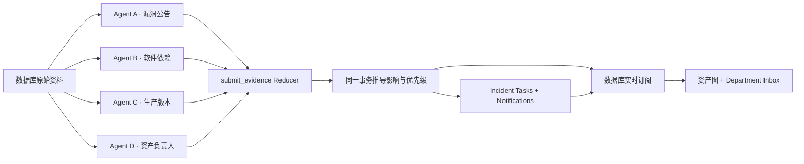

# Lattice — Cyber Incident Command Center

**四个独立 Agent 提交证据，数据库推导安全态势并生成部门任务。**

ASTER Commerce · `DEMO-SEC-001` · TokenGate Authentication Bypass

这是一个单公司、单漏洞、四 Agent 的可复现 MVP。漏洞与公司数据均为虚构。默认本地演示无需密钥；真实 Agent API 和 SpacetimeDB 接入口已分模块预留。

## 快速启动

需要 Node.js **22.12+** 和 pnpm。

```powershell
cd C:\Users\tingx\Documents\Hackathon\Lattice-HackUTD2026
pnpm install
pnpm dev
```

打开 http://127.0.0.1:5173。点击 **Inject Incident**，再启动调查；可切换快速演示或逐个运行 Agent。

```powershell
pnpm typecheck
pnpm test
pnpm build
```

默认运行的是 **Local simulator**：后端执行与 SpacetimeDB Reducer 相同的规则函数，通过 SSE 更新界面，将结果写入 `.data/world.json`。它不会假装已经连接 SpacetimeDB，也不会假装调用了大模型。

## 模块结构

```text
apps/
  web/              React 指挥界面、资产图、实时订阅、Department Inbox
  server/           本地数据库模拟器、持久化、SSE、演示控制
packages/
  contracts/        证据、资产、任务与数据库端口的 TypeScript 契约
  domain/           唯一的规则实现、虚构原始资料、规则验收测试
  agents/           四个独立调查运行器、确定性提取器、模型 API 适配器
spacetimedb/        真实 SpacetimeDB 表、身份权限、事务 Reducers
docs/               数据库接入、Agent 接入、90 秒讲稿
scripts/            开发启动脚本
```

根目录只保留项目配置和说明。运行数据、依赖及构建结果均被 Git 忽略；保留仓库原有 `LICENSE`。

## 数据流与权限边界



Agent 不读取其他 Agent 的资料，不通信，不提交风险、优先级或部门任务。前端只显示服务端结果。`packages/domain` 的规则函数在本地服务和真正的 `submit_evidence` Reducer 中复用；生产接入后，规则在 SpacetimeDB 事务内运行。

规则包括稳定语义版本范围比较、直接影响、传递依赖影响、业务优先级、部门任务与通知生成。任务按“事件 + 资产”确定唯一标识，重复证据不会生成重复通知。每个结论和任务都保留证据 ID；所有 Agent 停止后，世界状态独立存在。

## 接入位置

- **真实 SpacetimeDB**：从 [docs/database.md](docs/database.md) 开始。先发布模块、生成客户端绑定，再实现前端与 Agent 的连接端口。不要手写生成文件。
- **Agent API**：见 [docs/agents.md](docs/agents.md)。配置服务器环境中的模型地址、模型名称和 API Key；前端不得持有模型密钥。
- **演示流程**：见 [docs/demo-script.md](docs/demo-script.md)。

`.env.example` 列出可配置项。保持默认 `fixture` 模式即可离线复现证据提取；真实 API 模式仍只能返回结构化证据，数据库会验证角色、来源与字段。

## 验收与限制

| 验收项 | 本地可验证 | 真实服务接入后验收 |
| --- | --- | --- |
| 四个 Agent 独立读写数据库端口 | ✓ | 使用四个独立 SpacetimeDB 身份 |
| 数据库整合证据并推导 | 共享规则由本地服务执行 | Reducer 事务执行 |
| 一直接、两下游、一不受影响 | ✓ | 通过真实订阅复测 |
| 三部门任务与三通知记录 | ✓ | 通过真实表查询复测 |
| Agent 停止后仍可查询 | 本地持久化与重启测试 | SpacetimeDB 持久化复测 |

本项目没有真实邮件发送。Department Inbox 读取通知和任务记录。实际 SpacetimeDB 发布、生成绑定、外部模型调用需要你后续配置，尚未执行；页面会明确显示当前模式。
